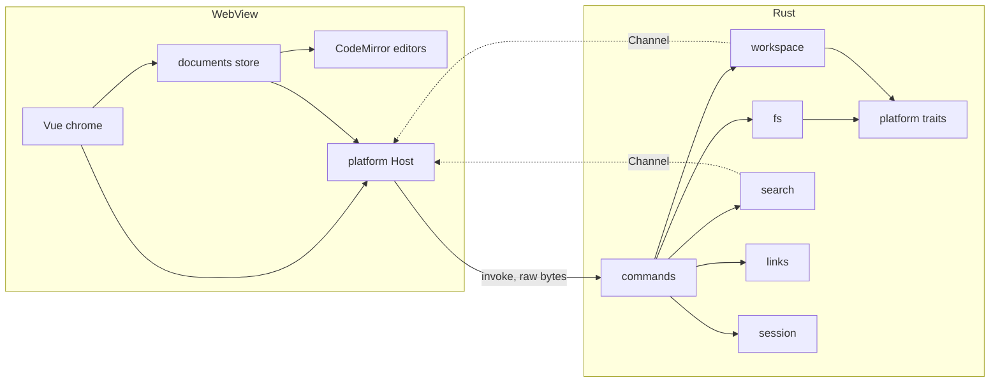
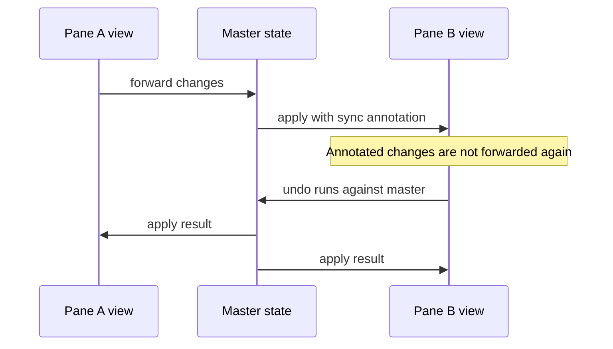
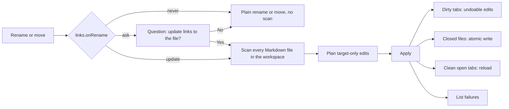

# Architecture

Keep this current: any change to structure or data flow updates this file in the same change. Phase 0 built the layout below as a skeleton; later phases fill it in.

## Overview



**Rule one: Vue owns the chrome, CodeMirror owns the text.** `src/editor/` imports no Vue, and editor objects never enter Vue reactivity. Widgets are plain DOM styled with tokens.

## Layout

```
mdmate/
├─ src/
│  ├─ platform/       Host interface, Tauri implementation, browser mock; git.ts (the git report and its parser)
│  ├─ editor/         CM6 only: livePreview/, commands/, theme.ts, keymaps
│  ├─ documents/      Document store, master state, save, conflict, session
│  ├─ workbench/      Split tree model, panes, tabs, pointer drag, commands
│  ├─ shell/          App layout: title bar with menu and caption buttons, sidebar frame, status bar
│  ├─ features/       tree/ (model, store, ops, gitModel, gitStore, FileTree.vue, FileIcon.vue, fileIcons.ts, NameInput.vue, CopyBanner.vue), drop.ts, palette/ (state, rows, PaletteHost.vue); later search, outline, settings
│  ├─ components/ui/  shadcn-vue, added only with `pnpm ui:add` (never edit by hand)
│  ├─ lib/            shadcn-vue utilities
│  └─ styles/         tokens.css (fonts, sizes, Tailwind map), themes/dark.css, light.css and sepia.css (every color)
├─ src-tauri/src/
│  ├─ commands/       Thin handlers, no logic
│  ├─ access.rs       Which paths the page may read: files the user chose, plus workspace roots
│  ├─ documents.rs    Open documents by id, and the open, save and close operations on them
│  ├─ fs/             Raw frame, encoding, line endings (eol), atomic write, round-trip guard, kind (what a file opens as, by extension)
│  ├─ workspace/      tree.rs (one folder per listing), roots.rs (workspace.json), folders.rs (watcher for the open folders), ops.rs (create, rename, move, delete to the Recycle Bin, copy in); file index later
│  ├─ drops.rs        The paths of the last native file drops, which are the only ones the page may ask about
│  ├─ search/         Streaming folder search
│  ├─ links/          Link guard (guard.rs), scanner (scan.rs), file walker (walk.rs), rewrite engine (rewrite.rs)
│  ├─ session/        Hot-exit store
│  ├─ git/            What git says about the files under a root: locate.rs (find the program), discover.rs (find the repositories), run.rs (start git, timeout, cap), status.rs (read the output), command.rs (the page's one question)
│  ├─ settings/       Settings and keybinding files
│  ├─ window_state.rs The window's normal bounds and the fit of a saved window to today's monitors
│  ├─ paths.rs        Data folder: `MDMATE_DATA_DIR`, else `<exe dir>/data` beside an `mdmate.portable` file, else the app-data folder
│  └─ platform/       Traits, windows/, macos/ and linux/ stubs
├─ scripts/           check-arch.mjs, check-isa.mjs, fixtures, perf
└─ tests/             Vitest suites and fixtures
```

## Documents

One headless master `EditorState` per open file owns the text and undo history. Each pane has one `EditorView` follower.



- Open documents live in a plain map in `src/documents/`. The chrome reads only a small reactive record per document (name, path, dirty, read-only reason, last save error), so editor objects stay out of Vue. A tab is a `{ kind, docId }` record, and several tabs can show one document. A document is dirty when its text or endings differ from the last saved snapshot, and it lives until its last tab closes.
- Deleting a file or folder from the tree asks first in a shadcn alert dialog (a modal, the owner's call; every other question in the app stays an inline banner), and closes the tabs of what it deleted.
- Closing the last tab of a dirty document asks first (Save, Don't save, Cancel) in a banner inside the pane. Closing the app asks nothing: hot exit keeps the edits.
- Each tab has a follower: a state with no history of its own, wired to the master. A follower that no view shows only notes the changes made elsewhere, as one composed change set, and applies it when its tab is next shown, so typing in one pane costs the parked tabs nothing.
- Undo and redo keys call the document, which runs them on the master and shows the result in every follower; the follower that asked also gets the caret the edit was made from.
- Undo lives on the master, so closing a pane never loses history.
- Switching tabs swaps state with `view.setState`, which keeps tabs cheap.
- The text in every state uses `\n` only. Each line break's original ending (`\r\n`, `\n` or `\r`) lives in a state field on the master, and Rust joins them back on save. `EditorState.lineSeparator` stays at its default, because keeping `\r` in the text hides tables and hard breaks from the Markdown parser.
- The field follows every edit: breaks an edit adds take the ending of the line they came from, breaks after it keep theirs, and undo puts back the endings of breaks it restores (through `invertedEffects`). Moving text, which is one deletion and one insertion of the same text and what a drag makes, carries the endings of the breaks inside it, so the field recognizes a move by that shape and needs nothing carried from the follower.

- Copy and cut hand over the file's bytes. Hidden Markdown syntax is still in the text, so it is copied, and the master's line endings are put back by `sourceCopy` (`src/editor/sourceCopy.ts`), a clipboard output filter in every follower that reads them through `FollowerLink.endings()`.
- A file above 3 MiB on disk opens as plain source: `Document` makes its tabs with no Markdown parser, and the pane shows a notice. The rule lives in `src/documents/largeFile.ts` and is decided once, when the document opens.

### Hot exit

- The page writes one snapshot of the session to `session.json` in the data folder: the split layout, each tab's file and caret, and every unsaved buffer with its text, its line endings and the hash of the file it was typed on. Rust adds the paths of the documents it has open, writes the file with the same temp-file-and-rename as a save, and at the next start grants exactly those paths. The data folder is Tauri's app data folder, or `MDMATE_DATA_DIR` when set.
- The snapshot also holds how the sidebar was left. `workspace.expandedPlaces` is the saved list of open places (a root is a place): when it is there the tree opens exactly those places, so a collapsed root stays collapsed and an empty list means everything was collapsed; without it (a first start, a damaged file, a session from before places) every root opens one level. A restored folder that cannot be listed any more is closed again without a message. `workspace.sidebarVisible` (written only when false) and `workspace.sidebarPanel` (only Search or Outline; the References list is a result that is not kept) bring back whether the sidebar was shown and its panel before the first paint.
- The snapshot also holds where the window was (`window`: x, y, width, height in physical pixels, and `maximized`), so it opens the same way next time. Rust (`window_state.rs`) remembers the last normal bounds, because a maximised window reports the whole screen, and the page reads them with `window_geometry` when the window moves or resizes (`workbench/windowShape.ts`) and once more at the close. At the next start `restoreSession` hands the saved value to `window_restore` before `App.vue` shows the window; `fit` (pure, tested) maps it to today's monitors: it stays if its title bar is still reachable and it fits, otherwise it is centred on the first monitor at its saved size reduced to fit, and never below 480 by 320. A session without the field leaves the window at `tauri.conf.json`'s size.
- The journal (`src/documents/session.ts`) writes 1000 ms after the last change (and at the latest 5000 ms after the first change when changes do not pause), one write at a time, and skips a snapshot equal to the last. Closing the window is stopped in Rust, the page flushes and calls `quit_app`, and Rust closes anyway after 3 s. The app never asks. Both ways end through `end_app` (`commands/mod.rs`), which destroys the windows and lets the event loop leave (`RunEvent::Exit` flushes the index cache); a hard `app.exit(0)` with the web view alive prints WebView2's `Failed to unregister class Chrome_WidgetWin_0. Error = 1412`.
- A start restores before the first paint: files open, unsaved buffers go back into their documents, then the layout and tabs. A file that changed since the buffer was typed raises the P2-T5 conflict banner. Text that cannot go back in a tab is kept in `recovered/` with a notice.

### Untitled documents, Save As and Open Recent

- An untitled document is an id in Rust (`Documents.untitled`) with no path and no table entry; the page's `Document` has an empty path and an untitled number. A save of it, and every Save As, goes through `save_as::save_as`, which takes the dialog as a parameter, refuses a file open in another tab, and on success gives the id its file (`promote`) and the page moves the same `Document` to it (`relocate`), keeping undo history.
- Hot exit stores an untitled tab as a tab with no path plus its buffer, both carrying its number; a restart gives it a new id and counts it as edited.
- An untitled document's images live in a draft folder, `<data folder>/drafts/<number>/assets/` (`drafts.rs`). Rust builds the path from the number the page sends with `document_new_untitled`, makes the folder with the first image, grants the asset scope for that one folder, and removes it when the tab's close is final (never on quit, since the session restores the tab). `drafts_sweep` removes the folders no tab holds, only after a restore with no problem. The first Save As copies the images the text links to beside the file, renames the links of any that had to get another name, and removes the draft; `SavedAs.renamedImages` lets the page make the same rename on its own text.
- Open Recent is `recent.json` in the data folder, owned by Rust: newest first, 10 files and 5 folders, atomic write, pruned of missing paths when read. Only Rust adds to it, and a recent entry is granted access again only if it is on the list.
- Close All (of one pane), Close Others, Close to the Right and similar commands go through one queue (`closeTabs`) that asks per dirty document in the pane banner, and Revert asks the same way.

## Live preview

CM6 lets only directly provided decorations change block structure, and only indirectly provided ones read the viewport. So preview has two layers.

| Layer | Built with | Handles | Rebuilds |
|---|---|---|---|
| Inline | `ViewPlugin` | Marks, hidden syntax, list and quote styling | When doc, viewport, active block or tree changes, over `visibleRanges` only |
| Block | `StateField` | Tables, images, frontmatter | Maps through edits, rescans changed ranges, extends as the parser advances |

Fenced code is not a widget. It stays editable text, parsed by the language its fence names (`src/editor/codeLanguages.ts`) and colored with the theme's `--syntax-*` tokens (`src/editor/highlight.ts`).

Built so far are the inline layer and the block layer (tables, images, frontmatter).

- `scanPreview(state, ranges)` (`src/editor/livePreview/scan.ts`) is a pure function from a state and ranges to `hide`, `mark` and `line` items for headings, emphasis, strikethrough, inline code, links, autolinks, lists, quotes and rules, read from the GFM tree (`markdownSupport()`). `livePreview()` is the `ViewPlugin` that turns the items over `visibleRanges` into decorations, plus a second set holding only the hides, which serves as atomic ranges so the caret skips hidden syntax.
- The reveal rule: an inline element shows its syntax while any selection range touches it, edges included. A block marker shows while a range touches its line. Nothing hides across a line break, so a caret is never strictly inside hidden syntax.
- The block layer (`src/editor/livePreview/blocks/`) is a `StateField` that keeps one decoration set of widgets that replace whole lines, and edits it instead of rebuilding it. An edit maps the set through the changes and rescans the lines around the change (one more line each side, since a table's shape depends on its neighbours). A selection that moves rescans the blocks the old selection touched and the ones the new one touches. When the parser advances, the stretch it has newly parsed is scanned. A block is drawn only while no selection touches it (edges included), and it is removed in the same transaction that moves the selection, so no selection is ever inside a replacement. That is why Phase 4 needs no filter to keep a caret out of a hidden replacement (ISC-183).
- `scanBlocks` (`blocks/scan.ts`) is the pure scan, a function of the state. Only top-level nodes are blocks, with one exception: a table inside list items is drawn too, because the only prefix of its lines is the indent, which the widget keeps as an invisible gap (`TableItem.indent`). A table inside a quote, or one on a list marker's line, stays source, because the `>` or the marker would be lost. Widgets (`blocks/widgets.ts`) are plain DOM built with `createElement` and text nodes, with `eq()` on the block's source (so an edit elsewhere keeps the DOM) and `estimatedHeight`. Spacing is padding, never margin.
- Images (`blocks/image.ts`, `ImageWidget`) are the second block kind. An image alone on its line is a block replacement of that line; one inside text is an inline replacement. Only top-level paragraphs are scanned, so an image in a list, a quote or a table stays Markdown. The address rule is one allowlist function, `resolveImageAddress`: a relative path inside the document's folder, or `https`. The folder and the asset URL come from an `imageContext` facet that each `Document` supplies from its path and the host's `assetUrl`. Rust grants the asset scope for the document's folder when it opens the file (`access::asset_folder`); the page cannot widen it. A widget holds a fixed box from its first draw (the remembered size of that address, or a placeholder of 160 px for a block and 20 px inline) and asks CodeMirror to measure when the image loads or fails. A loaded size is applied inside the view's own measure cycle: CodeMirror makes up for a height change only above the block holding a point 12 px under the top, so for an image in the zone between that block and the first visible line the widget scrolls to put that line back (the line is chosen in the read phase, before any image in the cycle has changed). Several images loading in one frame each restore only their own growth.
- A table is read-only. Pressing a cell puts the caret in that cell's source, which reveals the table's Markdown.
- Frontmatter (`src/editor/livePreview/frontmatter.ts`) is the third block kind. Where it is comes from the text, not the tree: `---` on line 1 and the first later line that is `---` or `...`, within 200 lines. A parser extension was rejected because CodeMirror reuses the parse of an unchanged first line, so typing the closing line far below would not have turned the block on. `scanBlocks` returns one pill item over the whole range and skips every node inside it; `scanPreview` skips the same nodes, and while a selection touches the block it puts `cm-md-frontmatter-line` on each line so the highlighter's heading style does not show through the plain YAML.
- A bullet list marker (`-`, `*`, `+`) is a `bullet` item while no selection touches it, drawn as an en dash by `livePreview/bullet.ts` (a hidden hyphen sets the width, the dash is laid over it); the raw marker shows under the selection, and the bullet is one step for the caret.
- Line numbers (`src/editor/lineNumbers.ts`, setting `editor.lineNumbers`, off by default) are a gutter of our own on every editor state. The editor carries `cm-lineNumbersOn` while the setting is on, `refreshLineNumbers()` redraws every open view when the file changes it, a block widget is numbered by its first source line, and the frontmatter pill has no number. With word wrap centring the column, the gutter takes the free space on the column's left so the two sit together. Its look is two theme tokens, `gutter` (the strip) and `gutter-foreground` (the numbers), in the editor group of the color editor; the numbers are in the code family at 0.8 times the code size, and the number of the caret's line keeps `--foreground`. Its line height is the body line height times the body size, so the numbers stay on their lines.
- The room beside the text (1.5rem each side) is padding on `.cm-scroller`, not on `.cm-content`, so the content box is the text column. CodeMirror draws the highlight of a whole selected line from the content box's own edge, inset by the first line's padding only, so room inside the box would be painted. With line numbers on the scroller gives up its left room and the content takes it as a margin, which keeps the gutter at the pane's edge. `--doc-content-max` is the column width (`900px`), because the room is outside the box. Vertical room stays padding on the content.
- Checkboxes (`src/editor/livePreview/checkbox.ts`) are inline: `scanPreview` returns a `checkbox` item for a `TaskMarker` that no selection touches, and the widget is a native checkbox. A press changes the one character between the brackets through the view (`input.toggle`, its own undo step, nothing when `state.readOnly`). Line endings are not in the editor text, so the saved file differs in that one byte.
- Fenced code languages (`src/editor/codeLanguages.ts`) are passed to `markdown()` as `codeLanguages`, a function from the fence word to a `LanguageDescription` whose `load` does `import('@codemirror/language-data')`, finds the language by name or alias, then by file extension (`py`, `rs`), and loads that one parser. Until it resolves the block is parsed as plain text; when it does CodeMirror reparses the block, which takes a fraction of a second to a second. A word the list does not know is plain text. Descriptions are kept per word (at most 128), so a language loads once however many blocks use it. The list is code too, so a document with no fence word never loads it. `scripts/check-arch.mjs languages-lazy` checks this in two ways: no static import of a parser package in `src/`, and, given a build with source maps (`--dist`, default `dist/`), no language package in the chunks the page loads first except the six that `@codemirror/lang-markdown` itself imports.
- Syntax colors (`src/editor/highlight.ts`) are one `HighlightStyle` over the Lezer tags that every language package uses, so code in any language and the Markdown source in raw mode are colored by the same tokens. Every color is a `var(--syntax-*)` name and the test checks each exists in every theme file; a new theme has to define them.
- One filter is still needed, for a different reason: CodeMirror's vertical step lands on the line below a block widget and never inside it, because the widget has no line of text. `stepIntoBlock` (in `blocks/field.ts`) turns a keyboard step onto the line just past a drawn block into a step onto its first (down) or last (up) line. Clicks, searches and long jumps are left alone. jsdom has no layout, so the real behaviour is checked in a browser and in the real window.
- Each pane shows live preview or raw Markdown by its own flag (`src/workbench/rawMode.ts`, Ctrl+E). `PaneEditor` (`src/workbench/paneEditor.ts`) owns the pane's view and applies the pane's mode every time a tab is shown, so a tab moved between panes follows the pane it is in. The switch is a `Compartment` (`src/editor/previewMode.ts`) holding the same constant extension, reconfigured through the follower so it is never an edit. A plain-source tab has no compartment, so the toggle does nothing there.

### Tab menu and Find File References

- The tree hides the names in `workspace.hiddenNames` (default `.git`, `.idea`, `.vscode`, `.vs`, `.svn`, `.hg`, `.DS_Store`, `Thumbs.db`; exact, any case, files and folders, any depth, never a root). It is a page-only setting: `flatten` in `features/tree/model.ts` skips the names when the rows are built, so the listings from Rust stay whole (`list_dir` is unchanged, and the git status work needs `.git`), a change reaches the tree at once, and search, Quick Open, link scans and the index see every entry. It is separate from `workspace.excludedFolders`, which feeds the index and search and would also hide `node_modules`.
- The installed font families come from Rust: `Platform::font_families` (`platform/mod.rs`, an Unsupported default, implemented by the three OSes through `platform/fonts.rs`, which reads the system's font folders with the `fontdb` crate), the command `list_font_families`, and `Host.listFontFamilies`. Loading all the fonts takes about a second, so nothing asks at startup: `features/settings/fontList.ts` reads them the first time a font field opens and keeps the answer. The three font fields in Settings are text fields with a dropdown (`FontPicker.vue`); the typed text is the value, so a saved stack or an uninstalled family stays as written.
- The sidebar's minimum width is what its tab strip needs (`SidebarFrame.vue` measures the padding, the tabs, the gaps and the border; `setSidebarMinimum` in `workbench/sidebar.ts` holds it, and the drag, the arrow keys, `aria-valuemin`, the frame's `min-width` and a width restored from the session all read it). It is measured again when a tab appears or goes (References), when a tab changes size and when the window is resized, and a width below it is raised to it. `SIDEBAR_MIN` (12rem) is only the fallback before the first measure.
- The tab context menu (`workbench/tabMenu.ts`, drawn in `TabStrip.vue`) works on the right-clicked tab, not the active one: copy path (native, through the page clipboard), copy path from the innermost open folder (`/`), reveal in the file manager or in the sidebar, rename (the tree's name box, so the link rewrite flow applies; Save As for an untitled tab), close, close others (`closeTabs`) and close all. F2 and the menu share one rename function. Rename and Reveal in Sidebar are off for a file outside every open folder (the tree has no row for it), and the off Rename item shows the reason in a shadcn tooltip. Shift+F12 runs Find File References.
- `find_references` (`links/references.rs`) walks the open folders, reads each file once (open unsaved documents from their buffers) and keeps the links whose target is the file, using the same `Wanted` resolution as the rewrite plan, so a listed link is one a rename would change. At most 2000 links; files it could not read are listed. The page shows the answer in a References panel in the sidebar (`features/references/`, panel state in `workbench/sidebar.ts`).

### Links

- Ctrl+click (Cmd+click on a Mac) on a link follows it; any other click only places the caret. `src/editor/links.ts` finds the link under the pointer and its target as written (reference definitions are looked up in the text), and hands it to the `followLink` option each `Document` passes to its tabs.
- `src/documents/links.ts` sends the document id and the target to Rust's link guard (`followLink`) and acts on the answer: a heading jump, the Markdown file in a tab (`openPath`, so an open file's tab is focused), nothing more for a web link or an image, or a banner in the pane asking before another file opens in its default app.
- Missing targets are drawn broken (`src/editor/brokenLinks.ts`): a view plugin asks Rust (`check_links`) about the relative inline links on screen, in the background, and redraws when an answer changes. Answers are shared per document and asked again after 5 s.
- Following a link records a jump in `src/documents/history.ts`; Alt+Left and Alt+Right are commands that walk it across tabs. Keys the app's commands use (`APP_KEYS` in `src/editor/create.ts`) are taken out of CodeMirror's default keymap, because the app leaves a key the editor handled alone.
- Heading anchors follow GitHub's slugs and are read from the text, not the tree (`src/editor/headingSlug.ts`), so a jump works before the parser reaches the end of a long file. `Follower.reveal` puts the caret on the heading and scrolls it to the top, also for a tab that is shown later.

### Editing commands

- Formatting is a set of pure functions in `src/editor/format.ts` from a state to the change they make (toggle bold, italic, inline code, strikethrough; insert a link; raise or lower headings). They read the syntax tree to see what is already formatted. The registry commands `format.*` run them on the active tab's follower, so the change reaches the master and undoes in one step.
- List keys (`src/editor/lists.ts`) sit above CodeMirror's Markdown keymap in every state with the parser: Enter continues a list through CodeMirror's `insertNewlineContinueMarkup` and ends it, or steps out a level, on an empty item; Tab and Shift+Tab move an item and its children one level in or out; outside a list, Tab inserts a tab and Shift+Tab outdents, and the indent unit is a tab.
- An `` tag draws like a Markdown image (`blocks/imageTag.ts`, read by `scan.ts`). The text must be exactly one `` on one line with a `src`; only `src`, `alt`, `title`, `width` and `height` are read, so no `style`, `on*` or `srcset` ever reaches the page. The address goes through the same `resolveImageAddress` allowlist (after character references are read), and a width or height of whole pixels sizes the frame (`shownSize`). The parser sees a tag alone on a line as an HTML block and one in a paragraph as an inline tag; both are scanned, and other HTML stays source.
- A click on a drawn image selects it (`blocks/imageSelect.ts`): a per-view flag with the image's source range, caret untouched. A selected image gets an outline and, once loaded, a bottom-right handle (`imageHandle.ts`); Delete, Backspace, Escape, Enter and the arrows act on it. A drag keeps the ratio between 24 px and the text column and writes the width once on release (`imageEdit.ts`): `` becomes `` (refused when it would not read back the same), an `` has only its `width` set and its `height` removed, and a Markdown image that began a paragraph that goes on gets one line break after the tag so the next line stays out of its HTML block.
- Pasting a picture (a screenshot, or files copied in Explorer: both arrive as `File`s in `clipboardData.files`, with no path) saves it next to the document and inserts `` at the caret as one edit (`src/editor/imagePaste.ts`, `src/editor/paste.ts`). The editor only holds an `ImageSink` facet; the document provides it and calls the host's `savePastedImage(id, bytes, stamp)`. Rust (`images.rs`, command `image_paste`) takes the document id and the bytes, looks up the folder in its own record of the document, reads the type from the bytes (PNG, JPEG, GIF, WebP), builds the name (the page's local-time stamp, held to `YYYYMMDD-HHMMSS`; a taken name gets `-2`, `-3`) and creates the file with `create_new`, so an existing file is never opened for writing. It refuses an `assets` that is a file or leads out of the folder and a document that cannot be edited; a document with no file saves into its draft folder. The page never names a path.
- Pasting a web address over selected plain text makes a link (`src/editor/paste.ts`). lang-markdown's own `pasteURLAsLink` is switched off in `markdownSupport()` because it edits read-only documents. Multiple selections stay off (CodeMirror's default), and a test fails if any state turns them on.
- Drag-to-move for selected text (`src/editor/textDrag.ts`) is in every editor state. It runs on pointer events because native file drops are on, moves the text in one transaction, and treats drawn block widgets as no drop target.

CM6 parsing is budgeted and can stop on huge files, so whole-document features, such as outline and link scans, run in Rust.

## Files and IPC

- File reads return `tauri::ipc::Response`, and writes send raw bytes, avoiding JSON.
- A document crosses IPC as one raw frame in both directions: a JSON header, the line-ending exceptions as `u32` pairs, then the text with `\n` as its only break (layout in `src-tauri/src/fs/frame.rs`). Rust decodes and encodes; the page never sees a BOM, a UTF-16 byte or a `\r`.
- The page opens a file and gets a document id, then saves by that id. It never names a path to write to.
- Rust allows a path only if it saw the user choose it (the open or folder dialog, a restored session, a native drop) or it lies inside a workspace root. Paths are compared with symlinks resolved, and network paths are refused. The page has no command that names a path to grant. The one way a link widens access is `follow_link` on a Markdown target: Rust resolves it against its own record of the linking document and grants that one file.
- A file that would not decode and encode back to the same bytes opens read-only, as does any encoding other than UTF-8 and UTF-16 with a BOM.
- Saves write a temp file in the same folder, then rename.
- Each save records the hash of what it writes before it writes, so the watcher can ignore mdmate's own writes. Rust decides whether a file changed by comparing content hashes, never by event or timestamp: it keeps, per open document, the hash the page last read or wrote, and says nothing about a file whose content matches it.
- A save first compares the file on disk with that hash and refuses (`disk-changed`) when they differ, so a change the watcher missed is still never overwritten. The page then asks: keep mine or load theirs.
- One `notify` watcher watches the folders of open documents (not the files, since replacing a file drops a watch on some systems). A dedicated thread waits for a path to go quiet for 100 ms, reads the file, and sends `{id, hash}` over a `Channel` when the content is news. A missing or locked file says nothing; the tab keeps its text.
- The page brings a clean tab up to date with `Document.reload` (new master, fresh undo history, one minimal change to every follower so carets stay put). A tab with edits raises a conflict and keeps them.
- A file opens by its extension alone (`fs/kind.rs`): Markdown, an image, or text. A tab is a union on `kind`: a Markdown or text tab holds a document (a text tab is plain source, with no parser), an image tab holds a path and a size and no document. The image view (`src/workbench/ImageView.vue`) shows the picture through `` only, from the asset protocol, so an SVG's scripts never run. `image_info` checks access, requires an image kind, allows that one file on the asset scope and notes it, so the session grants it again at the next start; `image_closed` forgets it when the last tab for it closes. A native drop opens through `drop_open`, which refuses the whole drop if one path was not delivered, and the page opens each file in the pane under the pointer.
- Workspace roots are kept by Rust in `workspace.json` in the data folder, written atomically when one is added or removed and granted again at start; the session snapshot only remembers which folders were open. Removing a root revokes Rust's access at once; the image protocol's scope can only grow, so it keeps the folder until restart.
- The sidebar lists one folder at a time (`list_dir`, folders first, then case-insensitive names) and asks again whenever a folder opens. A second `notify` watcher, non-recursive, watches exactly the folders the page says are open (`watch_folders`) and sends the changed folder's path over a `Channel`; the page lists that folder again and the newest answer wins.
- Files and folders dragged in from Explorer reach Rust as `DragDropEvent::Drop`; Rust records the paths of the last four drops, and `drop_describe` and `add_dropped_root` accept only those. The page decides what a drop means from where it landed (positions are divided by `devicePixelRatio`) and never names a path.
- Search, watcher and rewrite results stream over `Channel`.
- Hot exit journals dirty buffers to the data folder on a measured interval.

## Link rewrite



The scan covers the workspace roots that hold the file at any depth (all of them when roots lie inside one another; another workspace is not read), plus the open documents with unsaved edits. Only Markdown files are read, none under the built-in excluded folders of the workspace index (`node_modules`, `.git`, `target`, `dist`, `build`, `.idea` and the rest), and binary files are skipped. Find File References looks in the same roots.

The page decides first (`src/features/links/rewrite.ts`): `settings.links.onRename` is `never` (the default), `ask` or `update`, and until `settings.json` exists the `MDMATE_LINKS_ON_RENAME` variable, read by Rust, wins over it. `never` calls the plain rename or move and nothing else. Otherwise `rewrite_check` runs the move's own checks without reading any file, so a bad name is refused where it was typed; `ask` then shows the question in the sidebar banner with Yes first and focused, then No and Cancel. Only Yes (or `update`) runs the two calls: `rewrite_plan` scans in the background with progress and returns the counts under a token, and `rewrite_move` moves and applies at once, with no second question. The banner then says how many links were updated in how many files. Rust (`links/flow.rs`) never writes a file that is open: it names the clean ones for the page to reload and returns text edits for the dirty ones, which the page applies to the editor as one undoable step.

## Quick open and command palette

Ctrl+P lists files and Ctrl+Shift+P lists commands, in one picker (`src/features/palette/`). `state.ts` is the only part in the entry chunk (which picker is open, and focus handling); `PaletteHost.vue` and `rows.ts` load with `import()` the first time one opens, and the `palette-lazy` rule in `check-arch` keeps it so.

Files come from Rust. `workspace/quick.rs` keeps a list of every file under every root except `.git` (the link scan's walk), builds it on the first query and again in the background each time the picker opens, and answers `quick_open_query(query, limit)` with the best matches and the letters to mark, as UTF-16 offsets. The page never holds the file list. Commands come from the registry; their titles are ranked by `src/lib/fuzzy.ts`, which uses the same points as the Rust scorer. The browser host answers the same two calls from its in-memory files with `fuzzy.ts`.

## Settings

`settings.json` lives in the data folder next to `session.json` and is the source of truth: JSON with comments (`//` and block comments, trailing commas), two-space indent, nested by group (`{"fonts": {"size": 18}}`), unknown keys left alone. The page reads and edits it with `jsonc-parser` (`lib/settingsFile.ts`, `lib/settingsEdit.ts`); an edit changes only the key it was given and never a comment. A file that holds nothing is written as a commented template of every setting (`features/settings/templates.ts`) when `settings.json` is opened, and an entry taken out gets its commented example back, so a file at all defaults reads like that template. `keybindings.json` works the same way, with its template built from the command registry. Rust (`settings/mod.rs`) keeps only the file: read, atomic write, a watcher on the data folder filtered to that name, and `settings_file`, which makes the file if it is missing and grants that one file so the page can open it as a tab. No call takes a path from the page, so nothing in an opened folder can stand in for it.

The page holds one validator, a table of every key with its file path, default and check (`src/lib/settingsFile.ts`). Data enters as `unknown`; a key with a bad value keeps its last good value and is flagged, a key the file lacks goes to its default, and a file that is not one JSON object changes nothing. `features/settings/store.ts` reads the file at start (before the session is restored) and again each time the watcher fires, puts the result in the reactive `settings` object (`src/lib/settings.ts`), and writes a change from the screen as an edit of one key of the file's text (`src/lib/settingsEdit.ts`): other keys stay, a value equal to the default takes its key out, and a file that is not valid JSON is never overwritten. Writes run one at a time, each on the file as it is when its turn comes. `MDMATE_LINKS_ON_RENAME` still wins over `links.onRename` for a run.

Keys that Rust has to act on reach it through one command, `settings_apply` (`settings/runtime.rs`): the paste folder, the recent caps, the excluded folder names, `devtools` and the two git keys (`git.enabled`, `git.path`). The page validates and pushes only when the values changed; Rust checks them again and refuses the lot if one is wrong. `AppState.runtime` holds the paste folder and `devtools`, `RecentStore` holds its two caps, and `fs/exclude.rs` holds the excluded list that the walker, the watcher and the index read (a changed list rescans every root). `Runtime` holds the two git values (`git_enabled()`, `git_path()`, set by `set_git`); `git.path` is read in one spelling on both sides (trimmed; empty means find it; at most 500 characters; no control characters; a drive-letter or a leading `/` path only, never a UNC, `\\?\`, relative or `~` path), and `tests/data/git-paths.json` holds the cases both validators run. A draft keeps the fixed `assets` folder; `images.pasteFolder` applies at Save As. The developer tools are a `tauri` feature plus a command that refuses while the setting is off.

The Settings screen is a tab (`kind: 'settings'`, `workbench/tabs.ts`) that holds the group it shows. `openSettingsTab` in `workbench/store.ts` shows the one that exists, in whichever pane, or opens it in the active pane; a split never copies it, and a session that names two keeps the first. The tab is written to `session.json` with its group (`kind: "settings"`); a saved kind this version does not know is left out, never opened as a file. `SettingsView.vue` loads lazily from `PaneView.vue` (`settings-lazy`). Open Settings (Ctrl+,), Open settings.json, the menu and palette entries and the title bar gear are in `workbench/defaultCommands.ts`, `shell/menuEntries.ts` and `shell/TitleBar.vue`.

The screen is `features/settings/SettingsView.vue`, with one `SettingRow.vue` shell for every row and the wording and grouping in `features/settings/rows.ts` (a `pair` control holds two keys in one row, the second marked `drawnIn` so it keeps its own template note but has no row of its own); values, defaults and checking stay in `lib/settingsFile.ts`. Controls hold no value: a change goes through `requestSettingChange` in `features/settings/store.ts`, which writes one key (or asks first, through `pendingSettingChange`, when the `settings.json` tab has unsaved edits) and then shows what the file says. The screen's banner reads `settingsFileState.broken`, the row errors read `settingsFileState.problems`, and `MDMATE_LINKS_ON_RENAME` locks the Links row through `host.linksOnRenameOverride`.

The document fonts (`fonts.*`) are applied by `editor/documentFonts.ts`: the store calls `updateDocumentFonts` after every applied file, which sets `--doc-*` custom properties on the root (the code size as a ratio of the text size, and the body and code line heights as unitless numbers, which headings, lists and tables inherit from `.cm-content` and only the code box overrides) and asks each open editor view to measure again, and only when a value changed. The editor's theme (`create.ts`, `livePreview/theme.ts`, `blocks/theme.ts`, `box.ts`) is the only reader, with the defaults as `var()` fallbacks. A family field is turned into quoted names plus the built-in stack by `cssFamilyList`.

A command may carry a `state()`, which the palette rows and the menu show as On or Off. Toggle Word Wrap and Toggle Developer Tools flip their setting through `features/settings/quick.ts`, which uses the Settings screen's change path and shows the Settings tab when unsaved settings.json edits hold the change. Switch Theme opens the palette in its `themes` mode, a pick list of `lib/themes.ts`.

The web view's own browser shortcuts (reload, view source, find, zoom) are off: `Platform::disable_browser_keys` runs once from `setup` in `lib.rs`, and on Windows it clears WebView2's `AreBrowserAcceleratorKeysEnabled` (`platform/windows`, through `with_webview`). The app's shortcuts are handled in the page, so they are unaffected, and F12 reaches `open_devtools` through `devtools_open`, not an accelerator.

The window zoom is the `view.zoom` setting (percent, 50 to 300). Zoom In, Zoom Out and Reset Zoom (`Mod+=`, `Mod+-`, `Mod+0`, with a plus typed with Ctrl as an alias handled in `workbench/keyboard.ts`) and Ctrl+wheel (`workbench/zoomWheel.ts`) step it through `features/settings/zoom.ts`, which writes the setting like any other change. `updateZoom` (`features/settings/zoomApply.ts`) hands the level to the web view with `host.setZoom` after every settings read, the first time always; the web view does the scaling, so the pixel ratio includes the zoom and pointer positions stay in CSS pixels.

File rows in the sidebar show an icon by file type. `features/tree/fileIcons.ts` is a pure map from a file name to an icon id (whole name first, then the longest extension, case-insensitive, a default for unknown names), and `FileIcon.vue` draws the id as a `<use>` into `public/file-icons.svg`, one local sprite of a Material Icon Theme subset (MIT; its licence is `public/file-icons-LICENSE.txt`). The sprite is made by `scripts/build-file-icons.mjs` from the ids the map lists, and a test keeps the two in step. Folder rows keep their Lucide icons.

A tab can be pinned in its pane. The pin is part of the layout (`workbench/splitTree.ts`): a pane has an optional `pinned` count, and the pinned tabs are always its first `pinned` tabs, so the prefix rule holds by construction and `validateLayout` checks it. `pinTab` and `unpinTab` move a tab to the end of the pinned group or to the front of the rest; `closeTab`, `moveTab` and `moveTabToEdge` keep the count right, and a move holds the index inside the dragged tab's own group. The count is saved inside the layout text of the session, left out while it is zero, so the session version stays 1. The close commands that take many tabs (Close Others, Close to the Right, Close All, in `workbench/tabMenu.ts` and `documents/store.ts`) leave pinned tabs open; Close on one tab closes it. The tab strip (`TabStrip.vue`, `TabStripItem.vue`) shows the pin in the slot of the X, and the drop code (`tabDropTarget.ts`) clamps the preview and the index the same way `moveTab` does.

## Git status

`src-tauri/src/git/` answers one question for the page: the git status of every path under an open workspace root (`git_status(root, folders)` in `commands/mod.rs`; the page side comes with the colours in the tree). Nothing here writes, and nothing reads a `.gitignore` itself: git is the program the owner installed, asked only to read.

- **Finding git** (`locate.rs`): `git.path` when it names a file, else the `PATH`, else the standard install folders (`Platform::standard_git_paths`: under each Program Files and `LocalAppData` on Windows, `/usr/bin` and the like elsewhere). A `git.path` that names no file falls through to the next place. None found, or `git.enabled` off, gives an empty answer and no error.
- **Finding repositories** (`discover.rs`): up from the root to the folder that holds it, three levels down (the built-in excluded folder names are skipped, links are not followed, at most 5000 folders are looked at), and one level down from each folder the tree has listed. A repository is a folder with a `.git`, a folder or a file (worktrees, submodules). The innermost repository decides about a path.
- **Running git** (`run.rs`): `git --no-optional-locks -c core.fsmonitor=false -C <repo> status --porcelain=v2 -z --ignored=matching`, no input, no error output, no prompt, no console window (`Platform::hide_console`, which sets `CREATE_NO_WINDOW` on Windows), killed after 20 seconds. At most four runs are alive at once in the whole app (a gate shared by every question). A start that fails, a bad exit and a timeout all leave that repository without an answer, and show nothing.
- **Reading the output** (`status.rs`): untracked, added, modified, renamed, conflicted and ignored. `-z` means no quoting, so spaces and non-ASCII names arrive whole. An untracked or ignored folder is one entry marked as a folder. A deletion or a type change is a modification, an intent-to-add file and a copy are added.
- **The command** (`command.rs`): the root must be one the user opened (`Access::is_root`), and listed folders outside it are dropped. The answer is `{repos, entries}`: the repositories as folders, and each entry with its repository's index, a full path with `/`, its status and whether it is a folder. An outer repository's entry that lies at or inside an inner repository is dropped, so a path is coloured by its innermost repository. A repository above the root reports only what lies under the root. The lock on the open roots is let go before git starts.

**The page side** (`platform/git.ts`, `features/tree/gitModel.ts`, `features/tree/gitStore.ts`). The host call is `gitStatus(root, folders)`; the Tauri host reads the answer with `parseGitReport`, so a malformed report fails there and shows nothing. `gitStore.ts` asks once per open root (with the folders open under it) when a root opens, restores or closes, when the window gets the focus back, after a save, a create, rename, move, delete or copy-in through the tree, on a tree-watcher event and when `git.enabled` or `git.path` changes. A burst is one question after 250 ms, the page waits for the settings to reach Rust first, an answer older than a newer question or for a removed root is dropped, and with git off the host is not asked. A failed call is the same as git saying nothing: no colour and no message. Opening a folder is not a trigger and `.git/` is not watched, so a repository deeper than three levels or a commit made in a terminal shows at the next one. Three hooks feed it: `onTreeChanged` and `onTreeReset` in the tree store (the host allows one tree listener) and `onDocumentSaved` in the documents store (which cannot import the tree).

`gitModel.ts` turns a report into an index once, so drawing a row is lookups. Untracked and added names are green, modified and renamed blue, a conflict is the destructive colour, ignored is muted; everything inside an untracked or ignored folder takes its status (also a folder entry above the root); a folder that holds any change but an ignored one is blue unless it has a status of its own; a root row only takes a status of its own or an inherited one; and an entry counts for a path only when its repository is the path's innermost one. `FileTree.vue` puts `text-git-added`, `text-git-modified`, `text-destructive` or `text-git-ignored` (written out whole) on the name. The tokens `git-added`, `git-modified` and `git-ignored` sit in the sidebar group of the theme editor, with contrast pairs against the sidebar and its selected row.

The untrusted-content stance holds: `core.fsmonitor` is forced off on the command line, so a repository's own config cannot make `status` start a program through it (a test sets one and proves it is not run). What remains is the filter programs a repository can name (`filter.<name>.clean`), which git runs for a file whose stat data is stale; git has no switch that turns them all off, so opening a repository from an untrusted source with `git.enabled` on carries that risk. Turn `git.enabled` off to close it.

## Security

Markdown content is untrusted, and people will open files they did not write.

- Document content never reaches `innerHTML` or `v-html`. `` tags are read for attributes only.
- `tauri-plugin-fs` stays out. All file access goes through our commands, keeping capabilities small.
- The link scanner (`links/scan.rs`) is pure: `scan(&str)` returns every link to a local file with the byte span of its path part, the raw and decoded path, its form, how it is wrapped and its line. `Link::render` writes a new path in the same style and `splice` and `apply` replace spans, so an edit never touches an anchor, a title or a quote. `links/walk.rs` walks a folder (skipping `.git` and links, junctions and mount points) and reads each file: UTF-8 and UTF-16 text is scanned on the text it decodes to, line endings intact, so an edit written back with the file's own encoding changes only target bytes; a file with a NUL byte and no UTF-16 mark is binary and a file in an encoding mdmate does not write is reported.
- The rewrite engine (`links/rewrite.rs`) is two calls around a move. `plan(roots, move, ignore_case, progress)` runs before it: it reads every text file under the roots and, for each link, works out where it leads now and where that place will be afterwards, using names only (the old place no longer exists once the move is done). A link is edited only when the same text from the file's new folder would no longer reach the same place; the new target is the relative path from the file's new folder, in the old link's style. It returns the edits per file with the hash of the bytes it read. `apply(plan)` runs after the move: for each file it refuses a read-only file or one whose bytes no longer match the hash, checks that each span still holds the planned text, writes through the atomic writer in the file's own encoding, and lists failures without stopping.
- One Rust module, `src-tauri/src/links/guard.rs`, decides what a link target may do. The page sends `describe_link` or `follow_link` the document id and the target as written; the folder comes from Rust's record of the document, and the page never names a path or URL to open.
- The guard reads the text first, with no file system call: only `http`, `https` and `mailto` pass as schemes (`file:` is refused), a path is percent-decoded once before any check, and rooted, network (`\\host`, `//host`, `\\?\UNC\`, encoded spellings), drive and stream paths, device names and executable types are refused. Only then does a relative path touch the file system, and the resolved path is checked again.
- Only a value the guard approved reaches the opener, which is `open_external` behind the platform trait (`ShellExecuteW` on Windows, with no parameters).
- Opening a file in its default app asks first, unless it is Markdown (opens in a tab, and Rust grants that one file) or an image. Programs, scripts, shortcuts and installers are refused, asked or not.
- UNC and `file://host/` targets are refused for links and images, because reading one makes Windows contact that host over SMB.
- SVG renders through ``, so its scripts cannot run.
- The CSP allows `https` for images only. The app makes no other network request.
- User theme files load only from `themes/` in the app data folder, are read as data and never run, and set token values: each value must be a hex color or an `oklch()` with plain numbers, and is checked again before it reaches a style. A theme file in an opened workspace is never read.

## Startup

The window starts hidden on a themed background and shows after first paint. Palette, settings, language parsers and search load on first use. Release builds use LTO and one codegen unit, and keep unwinding panics so a background thread crash cannot lose unsaved typing.

## Portability

- OS-specific Rust lives behind traits in `src-tauri/src/platform/`, with stubs for macOS and Linux from the start. Two methods serve the git work: `hide_console` (starts a console program with no console window; Windows sets `CREATE_NO_WINDOW`, the default does nothing) and `standard_git_paths` (where git usually lives; empty by default).
- Keybindings use `Mod`, which maps to Ctrl or Cmd.
- CI compiles on macOS and Linux on every push.
- The custom titlebar sits behind one component, so macOS can use native controls.
