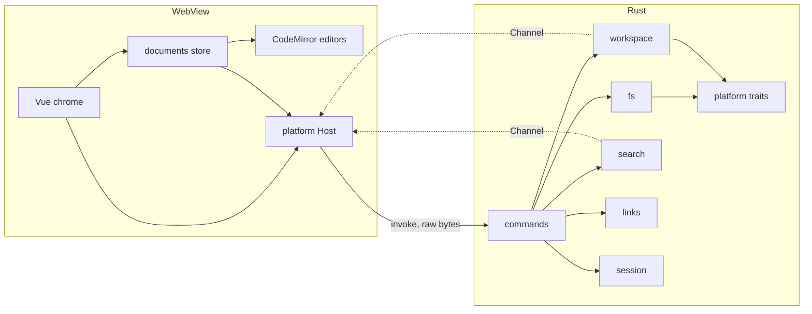
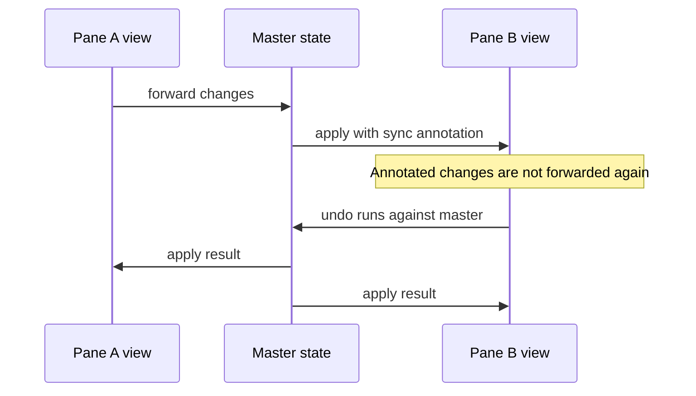
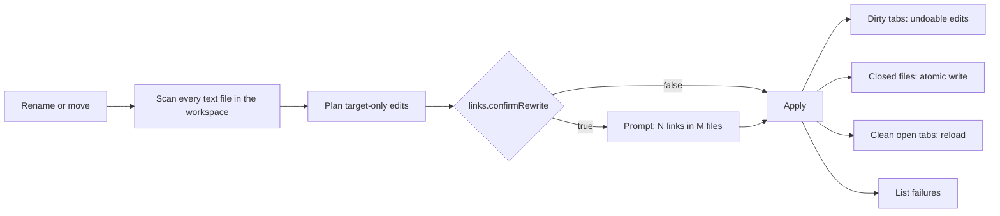

# Architecture

Keep this current: any change to structure or data flow updates this file in the same change. Phase 0 built the layout below as a skeleton; later phases fill it in.

## Overview



**Rule one: Vue owns the chrome, CodeMirror owns the text.** `src/editor/` imports no Vue, and editor objects never enter Vue reactivity. Widgets are plain DOM styled with tokens.

## Layout

```
mdmate/
├─ src/
│  ├─ platform/       Host interface, Tauri implementation, browser mock
│  ├─ editor/         CM6 only: livePreview/, commands/, theme.ts, keymaps
│  ├─ documents/      Document store, master state, save, conflict, session
│  ├─ workbench/      Split tree model, panes, tabs, pointer drag, commands
│  ├─ shell/          App layout: title bar with menu and caption buttons, sidebar frame, status bar
│  ├─ features/       tree, quick-open, palette, search, outline, settings, image-viewer
│  ├─ components/ui/  shadcn-vue, added only with `pnpm ui:add` (never edit by hand)
│  ├─ lib/            shadcn-vue utilities
│  └─ styles/         tokens.css (fonts, sizes, Tailwind map), themes/dark.css and light.css (every color)
├─ src-tauri/src/
│  ├─ commands/       Thin handlers, no logic
│  ├─ access.rs       Which paths the page may read: files the user chose, plus workspace roots
│  ├─ documents.rs    Open documents by id, and the open, save and close operations on them
│  ├─ fs/             Raw frame, encoding, line endings (eol), atomic write, round-trip guard
│  ├─ workspace/      Lazy tree, watcher, file index
│  ├─ search/         Streaming folder search
│  ├─ links/          Link guard, scan, rewrite
│  ├─ session/        Hot-exit store
│  ├─ settings/       Settings and keybinding files
│  ├─ paths.rs        Installed or portable data folder
│  └─ platform/       Traits, windows/, macos/ and linux/ stubs
├─ scripts/           check-arch.mjs, check-isa.mjs, fixtures, perf
└─ tests/             Vitest suites and fixtures
```

## Documents

One headless master `EditorState` per open file owns the text and undo history. Each pane has one `EditorView` follower.



- Open documents live in a plain map in `src/documents/`. The chrome reads only a small reactive record per document (name, path, dirty, read-only reason, last save error), so editor objects stay out of Vue. A tab is a `{ kind, docId }` record, and several tabs can show one document. A document is dirty when its text or endings differ from the last saved snapshot, and it lives until its last tab closes.
- Closing the last tab of a dirty document asks first (Save, Don't save, Cancel) in a banner inside the pane. Closing the app asks nothing: hot exit keeps the edits.
- Each tab has a follower: a state with no history of its own, wired to the master. A follower that no view shows only notes the changes made elsewhere, as one composed change set, and applies it when its tab is next shown, so typing in one pane costs the parked tabs nothing.
- Undo and redo keys call the document, which runs them on the master and shows the result in every follower; the follower that asked also gets the caret the edit was made from.
- Undo lives on the master, so closing a pane never loses history.
- Switching tabs swaps state with `view.setState`, which keeps tabs cheap.
- The text in every state uses `\n` only. Each line break's original ending (`\r\n`, `\n` or `\r`) lives in a state field on the master, and Rust joins them back on save. `EditorState.lineSeparator` stays at its default, because keeping `\r` in the text hides tables and hard breaks from the Markdown parser.
- The field follows every edit: breaks an edit adds take the ending of the line they came from, breaks after it keep theirs, and undo puts back the endings of breaks it restores (through `invertedEffects`). Moving text, which is one deletion and one insertion of the same text and what a drag makes, carries the endings of the breaks inside it, so the field recognizes a move by that shape and needs nothing carried from the follower.

- A file above 3 MiB on disk opens as plain source: `Document` makes its tabs with no Markdown parser, and the pane shows a notice. The rule lives in `src/documents/largeFile.ts` and is decided once, when the document opens.

### Hot exit

- The page writes one snapshot of the session to `session.json` in the data folder: the split layout, each tab's file and caret, and every unsaved buffer with its text, its line endings and the hash of the file it was typed on. Rust adds the paths of the documents it has open, writes the file with the same temp-file-and-rename as a save, and at the next start grants exactly those paths. The data folder is Tauri's app data folder, or `MDMATE_DATA_DIR` when set.
- The journal (`src/documents/session.ts`) writes 1000 ms after the first change, one write at a time, and skips a snapshot equal to the last. Closing the window is stopped in Rust, the page flushes and calls `quit_app`, and Rust closes anyway after 3 s. The app never asks.
- A start restores before the first paint: files open, unsaved buffers go back into their documents, then the layout and tabs. A file that changed since the buffer was typed raises the P2-T5 conflict banner. Text that cannot go back in a tab is kept in `recovered/` with a notice.

## Live preview

CM6 lets only directly provided decorations change block structure, and only indirectly provided ones read the viewport. So preview has two layers.

| Layer | Built with | Handles | Rebuilds |
|---|---|---|---|
| Inline | `ViewPlugin` | Marks, hidden syntax, list and quote styling | When doc, viewport, active block or tree changes, over `visibleRanges` only |
| Block | `StateField` | Tables, images, frontmatter | Maps through edits, rescans changed ranges, extends as the parser advances |

Fenced code is not a widget. It stays editable text highlighted by nested parsers, loaded per language.

CM6 parsing is budgeted and can stop on huge files, so whole-document features, such as outline and link scans, run in Rust.

## Files and IPC

- File reads return `tauri::ipc::Response`, and writes send raw bytes, avoiding JSON.
- A document crosses IPC as one raw frame in both directions: a JSON header, the line-ending exceptions as `u32` pairs, then the text with `\n` as its only break (layout in `src-tauri/src/fs/frame.rs`). Rust decodes and encodes; the page never sees a BOM, a UTF-16 byte or a `\r`.
- The page opens a file and gets a document id, then saves by that id. It never names a path to write to.
- Rust allows a path only if it saw the user choose it (the open dialog, a restored session) or it lies inside an open workspace folder. Paths are compared with symlinks resolved, and network paths are refused. The page has no command that grants access.
- A file that would not decode and encode back to the same bytes opens read-only, as does any encoding other than UTF-8 and UTF-16 with a BOM.
- Saves write a temp file in the same folder, then rename.
- Each save records the hash of what it writes before it writes, so the watcher can ignore mdmate's own writes. Rust decides whether a file changed by comparing content hashes, never by event or timestamp: it keeps, per open document, the hash the page last read or wrote, and says nothing about a file whose content matches it.
- A save first compares the file on disk with that hash and refuses (`disk-changed`) when they differ, so a change the watcher missed is still never overwritten. The page then asks: keep mine or load theirs.
- One `notify` watcher watches the folders of open documents (not the files, since replacing a file drops a watch on some systems). A dedicated thread waits for a path to go quiet for 100 ms, reads the file, and sends `{id, hash}` over a `Channel` when the content is news. A missing or locked file says nothing; the tab keeps its text.
- The page brings a clean tab up to date with `Document.reload` (new master, fresh undo history, one minimal change to every follower so carets stay put). A tab with edits raises a conflict and keeps them.
- Search, watcher and rewrite results stream over `Channel`.
- Hot exit journals dirty buffers to the data folder on a measured interval.

## Link rewrite



The scan covers all workspace roots at any depth, plus open tabs outside the roots. Only `.git` and binary files are skipped.

## Security

Markdown content is untrusted, and people will open files they did not write.

- Document content never reaches `innerHTML` or `v-html`. `` tags are read for attributes only.
- `tauri-plugin-fs` stays out. All file access goes through our commands, keeping capabilities small.
- The opener allows only `http`, `https` and `mailto`.
- Opening a file in its default app asks first, unless it is Markdown or an image.
- UNC and `file://host/` targets are refused for links and images, because reading one makes Windows contact that host over SMB.
- SVG renders through ``, so its scripts cannot run.
- The CSP allows `https` for images only. The app makes no other network request.
- Theme files load only from the settings folder and set token values.

## Startup

The window starts hidden on a themed background and shows after first paint. Palette, settings, language parsers and search load on first use. Release builds use LTO and one codegen unit, and keep unwinding panics so a background thread crash cannot lose unsaved typing.

## Portability

- OS-specific Rust lives behind traits in `src-tauri/src/platform/`, with stubs for macOS and Linux from the start.
- Keybindings use `Mod`, which maps to Ctrl or Cmd.
- CI compiles on macOS and Linux on every push.
- The custom titlebar sits behind one component, so macOS can use native controls.
