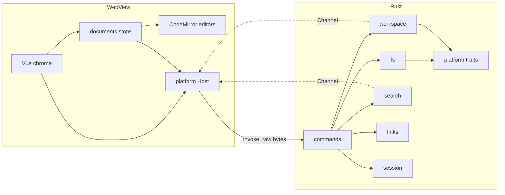
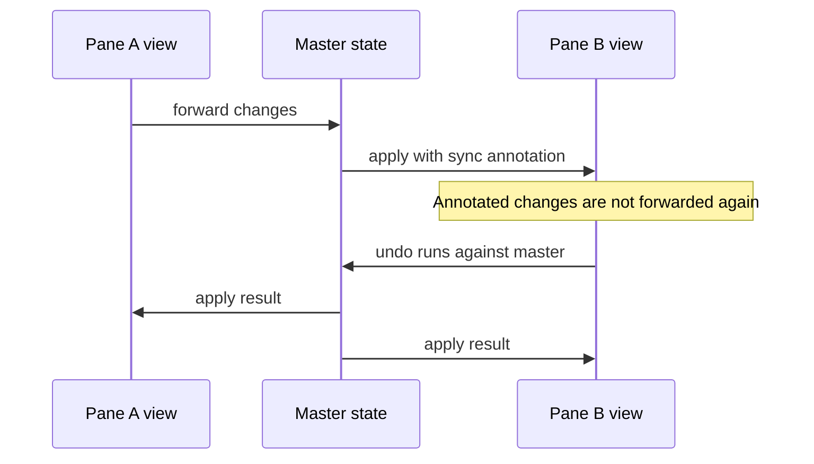
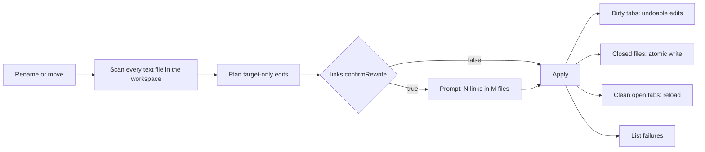

# Architecture

Keep this current: any change to structure or data flow updates this file in the same change. Phase 0 built the layout below as a skeleton; later phases fill it in.

## Overview



**Rule one: Vue owns the chrome, CodeMirror owns the text.** `src/editor/` imports no Vue, and editor objects never enter Vue reactivity. Widgets are plain DOM styled with tokens.

## Layout

```
mdmate/
├─ src/
│  ├─ platform/       Host interface, Tauri implementation, browser mock
│  ├─ editor/         CM6 only: livePreview/, commands/, theme.ts, keymaps
│  ├─ documents/      Document store, master state, save, conflict, session
│  ├─ workbench/      Split tree model, panes, tabs, pointer drag, commands
│  ├─ shell/          App layout: title bar with menu and caption buttons, sidebar frame, status bar
│  ├─ features/       tree, quick-open, palette, search, outline, settings, image-viewer
│  ├─ components/ui/  shadcn-vue, added only with `pnpm ui:add` (never edit by hand)
│  ├─ lib/            shadcn-vue utilities
│  └─ styles/         tokens.css (fonts, sizes, Tailwind map), themes/dark.css and light.css (every color)
├─ src-tauri/src/
│  ├─ commands/       Thin handlers, no logic
│  ├─ fs/             Read, atomic write, encoding, EOL detection
│  ├─ workspace/      Lazy tree, watcher, file index
│  ├─ search/         Streaming folder search
│  ├─ links/          Link guard, scan, rewrite
│  ├─ session/        Hot-exit store
│  ├─ settings/       Settings and keybinding files
│  ├─ paths.rs        Installed or portable data folder
│  └─ platform/       Traits, windows/, macos/ and linux/ stubs
├─ scripts/           check-arch.mjs, check-isa.mjs, fixtures, perf
└─ tests/             Vitest suites and fixtures
```

## Documents

One headless master `EditorState` per open file owns the text and undo history. Each pane has one `EditorView` follower.



- Undo lives on the master, so closing a pane never loses history.
- Switching tabs swaps state with `view.setState`, which keeps tabs cheap.
- `EditorState.lineSeparator` matches the file's own line ending.

## Live preview

CM6 lets only directly provided decorations change block structure, and only indirectly provided ones read the viewport. So preview has two layers.

| Layer | Built with | Handles | Rebuilds |
|---|---|---|---|
| Inline | `ViewPlugin` | Marks, hidden syntax, list and quote styling | When doc, viewport, active block or tree changes, over `visibleRanges` only |
| Block | `StateField` | Tables, images, frontmatter | Maps through edits, rescans changed ranges, extends as the parser advances |

Fenced code is not a widget. It stays editable text highlighted by nested parsers, loaded per language.

CM6 parsing is budgeted and can stop on huge files, so whole-document features, such as outline and link scans, run in Rust.

## Files and IPC

- File reads return `tauri::ipc::Response`, and writes send raw bytes, avoiding JSON.
- Saves write a temp file in the same folder, then rename.
- Each save records its hash, so the watcher can ignore mdmate's own writes.
- Search, watcher and rewrite results stream over `Channel`.
- Hot exit journals dirty buffers to the data folder on a measured interval.

## Link rewrite



The scan covers all workspace roots at any depth, plus open tabs outside the roots. Only `.git` and binary files are skipped.

## Security

Markdown content is untrusted, and people will open files they did not write.

- Document content never reaches `innerHTML` or `v-html`. `` tags are read for attributes only.
- `tauri-plugin-fs` stays out. All file access goes through our commands, keeping capabilities small.
- The opener allows only `http`, `https` and `mailto`.
- Opening a file in its default app asks first, unless it is Markdown or an image.
- UNC and `file://host/` targets are refused for links and images, because reading one makes Windows contact that host over SMB.
- SVG renders through ``, so its scripts cannot run.
- The CSP allows `https` for images only. The app makes no other network request.
- Theme files load only from the settings folder and set token values.

## Startup

The window starts hidden on a themed background and shows after first paint. Palette, settings, language parsers and search load on first use. Release builds use LTO and one codegen unit, and keep unwinding panics so a background thread crash cannot lose unsaved typing.

## Portability

- OS-specific Rust lives behind traits in `src-tauri/src/platform/`, with stubs for macOS and Linux from the start.
- Keybindings use `Mod`, which maps to Ctrl or Cmd.
- CI compiles on macOS and Linux on every push.
- The custom titlebar sits behind one component, so macOS can use native controls.
