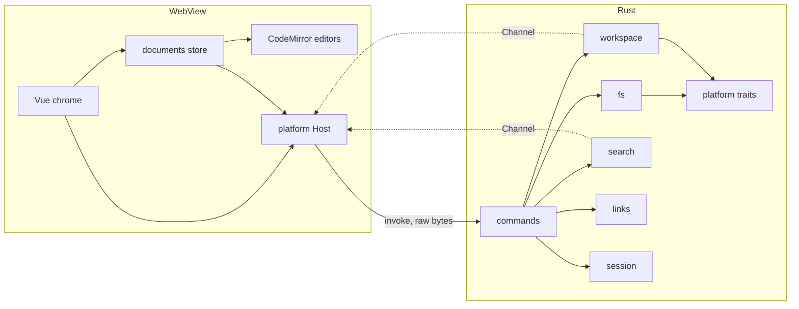
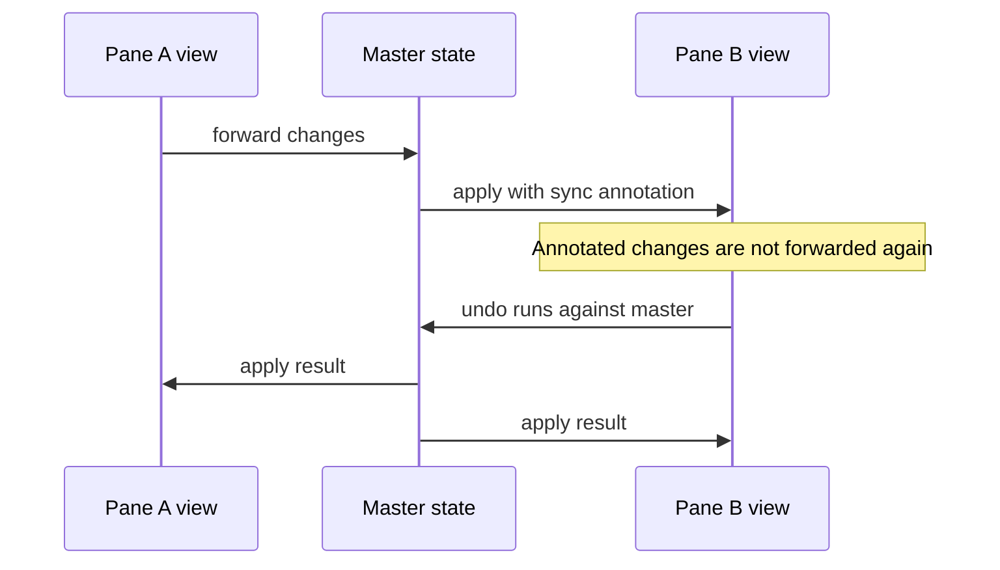
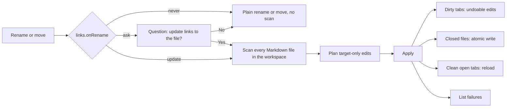

# Architecture

Keep this current: any change to structure or data flow updates this file in the same change. Phase 0 built the layout below as a skeleton; later phases fill it in.

## Overview



**Rule one: Vue owns the chrome, CodeMirror owns the text.** `src/editor/` imports no Vue, and editor objects never enter Vue reactivity. Widgets are plain DOM styled with tokens.

## Layout

```
mdmate/
├─ src/
│  ├─ platform/       Host interface, Tauri implementation, browser mock
│  ├─ editor/         CM6 only: livePreview/, commands/, theme.ts, keymaps
│  ├─ documents/      Document store, master state, save, conflict, session
│  ├─ workbench/      Split tree model, panes, tabs, pointer drag, commands
│  ├─ shell/          App layout: title bar with menu and caption buttons, sidebar frame, status bar
│  ├─ features/       tree/ (model, store, ops, FileTree.vue, NameInput.vue, CopyBanner.vue), drop.ts, palette/ (state, rows, PaletteHost.vue); later search, outline, settings
│  ├─ components/ui/  shadcn-vue, added only with `pnpm ui:add` (never edit by hand)
│  ├─ lib/            shadcn-vue utilities
│  └─ styles/         tokens.css (fonts, sizes, Tailwind map), themes/dark.css and light.css (every color)
├─ src-tauri/src/
│  ├─ commands/       Thin handlers, no logic
│  ├─ access.rs       Which paths the page may read: files the user chose, plus workspace roots
│  ├─ documents.rs    Open documents by id, and the open, save and close operations on them
│  ├─ fs/             Raw frame, encoding, line endings (eol), atomic write, round-trip guard, kind (what a file opens as, by extension)
│  ├─ workspace/      tree.rs (one folder per listing), roots.rs (workspace.json), folders.rs (watcher for the open folders), ops.rs (create, rename, move, delete to the Recycle Bin, copy in); file index later
│  ├─ drops.rs        The paths of the last native file drops, which are the only ones the page may ask about
│  ├─ search/         Streaming folder search
│  ├─ links/          Link guard (guard.rs), scanner (scan.rs), file walker (walk.rs), rewrite engine (rewrite.rs)
│  ├─ session/        Hot-exit store
│  ├─ settings/       Settings and keybinding files
│  ├─ paths.rs        Installed or portable data folder
│  └─ platform/       Traits, windows/, macos/ and linux/ stubs
├─ scripts/           check-arch.mjs, check-isa.mjs, fixtures, perf
└─ tests/             Vitest suites and fixtures
```

## Documents

One headless master `EditorState` per open file owns the text and undo history. Each pane has one `EditorView` follower.



- Open documents live in a plain map in `src/documents/`. The chrome reads only a small reactive record per document (name, path, dirty, read-only reason, last save error), so editor objects stay out of Vue. A tab is a `{ kind, docId }` record, and several tabs can show one document. A document is dirty when its text or endings differ from the last saved snapshot, and it lives until its last tab closes.
- Deleting a file or folder from the tree asks first in a shadcn alert dialog (a modal, the owner's call; every other question in the app stays an inline banner), and closes the tabs of what it deleted.
- Closing the last tab of a dirty document asks first (Save, Don't save, Cancel) in a banner inside the pane. Closing the app asks nothing: hot exit keeps the edits.
- Each tab has a follower: a state with no history of its own, wired to the master. A follower that no view shows only notes the changes made elsewhere, as one composed change set, and applies it when its tab is next shown, so typing in one pane costs the parked tabs nothing.
- Undo and redo keys call the document, which runs them on the master and shows the result in every follower; the follower that asked also gets the caret the edit was made from.
- Undo lives on the master, so closing a pane never loses history.
- Switching tabs swaps state with `view.setState`, which keeps tabs cheap.
- The text in every state uses `\n` only. Each line break's original ending (`\r\n`, `\n` or `\r`) lives in a state field on the master, and Rust joins them back on save. `EditorState.lineSeparator` stays at its default, because keeping `\r` in the text hides tables and hard breaks from the Markdown parser.
- The field follows every edit: breaks an edit adds take the ending of the line they came from, breaks after it keep theirs, and undo puts back the endings of breaks it restores (through `invertedEffects`). Moving text, which is one deletion and one insertion of the same text and what a drag makes, carries the endings of the breaks inside it, so the field recognizes a move by that shape and needs nothing carried from the follower.

- Copy and cut hand over the file's bytes. Hidden Markdown syntax is still in the text, so it is copied, and the master's line endings are put back by `sourceCopy` (`src/editor/sourceCopy.ts`), a clipboard output filter in every follower that reads them through `FollowerLink.endings()`.
- A file above 3 MiB on disk opens as plain source: `Document` makes its tabs with no Markdown parser, and the pane shows a notice. The rule lives in `src/documents/largeFile.ts` and is decided once, when the document opens.

### Hot exit

- The page writes one snapshot of the session to `session.json` in the data folder: the split layout, each tab's file and caret, and every unsaved buffer with its text, its line endings and the hash of the file it was typed on. Rust adds the paths of the documents it has open, writes the file with the same temp-file-and-rename as a save, and at the next start grants exactly those paths. The data folder is Tauri's app data folder, or `MDMATE_DATA_DIR` when set.
- The journal (`src/documents/session.ts`) writes 1000 ms after the last change (and at the latest 5000 ms after the first change when changes do not pause), one write at a time, and skips a snapshot equal to the last. Closing the window is stopped in Rust, the page flushes and calls `quit_app`, and Rust closes anyway after 3 s. The app never asks.
- A start restores before the first paint: files open, unsaved buffers go back into their documents, then the layout and tabs. A file that changed since the buffer was typed raises the P2-T5 conflict banner. Text that cannot go back in a tab is kept in `recovered/` with a notice.

### Untitled documents, Save As and Open Recent

- An untitled document is an id in Rust (`Documents.untitled`) with no path and no table entry; the page's `Document` has an empty path and an untitled number. A save of it, and every Save As, goes through `save_as::save_as`, which takes the dialog as a parameter, refuses a file open in another tab, and on success gives the id its file (`promote`) and the page moves the same `Document` to it (`relocate`), keeping undo history.
- Hot exit stores an untitled tab as a tab with no path plus its buffer, both carrying its number; a restart gives it a new id and counts it as edited.
- Open Recent is `recent.json` in the data folder, owned by Rust: newest first, 10 files and 5 folders, atomic write, pruned of missing paths when read. Only Rust adds to it, and a recent entry is granted access again only if it is on the list.
- Close All (of one pane), Close Others, Close to the Right and similar commands go through one queue (`closeTabs`) that asks per dirty document in the pane banner, and Revert asks the same way.

## Live preview

CM6 lets only directly provided decorations change block structure, and only indirectly provided ones read the viewport. So preview has two layers.

| Layer | Built with | Handles | Rebuilds |
|---|---|---|---|
| Inline | `ViewPlugin` | Marks, hidden syntax, list and quote styling | When doc, viewport, active block or tree changes, over `visibleRanges` only |
| Block | `StateField` | Tables, images, frontmatter | Maps through edits, rescans changed ranges, extends as the parser advances |

Fenced code is not a widget. It stays editable text, parsed by the language its fence names (`src/editor/codeLanguages.ts`) and colored with the theme's `--syntax-*` tokens (`src/editor/highlight.ts`).

Built so far are the inline layer and the block layer (tables, images, frontmatter).

- `scanPreview(state, ranges)` (`src/editor/livePreview/scan.ts`) is a pure function from a state and ranges to `hide`, `mark` and `line` items for headings, emphasis, strikethrough, inline code, links, autolinks, lists, quotes and rules, read from the GFM tree (`markdownSupport()`). `livePreview()` is the `ViewPlugin` that turns the items over `visibleRanges` into decorations, plus a second set holding only the hides, which serves as atomic ranges so the caret skips hidden syntax.
- The reveal rule: an inline element shows its syntax while any selection range touches it, edges included. A block marker shows while a range touches its line. Nothing hides across a line break, so a caret is never strictly inside hidden syntax.
- The block layer (`src/editor/livePreview/blocks/`) is a `StateField` that keeps one decoration set of widgets that replace whole lines, and edits it instead of rebuilding it. An edit maps the set through the changes and rescans the lines around the change (one more line each side, since a table's shape depends on its neighbours). A selection that moves rescans the blocks the old selection touched and the ones the new one touches. When the parser advances, the stretch it has newly parsed is scanned. A block is drawn only while no selection touches it (edges included), and it is removed in the same transaction that moves the selection, so no selection is ever inside a replacement. That is why Phase 4 needs no filter to keep a caret out of a hidden replacement (ISC-183).
- `scanBlocks` (`blocks/scan.ts`) is the pure scan, a function of the state. Only top-level nodes are blocks: a table inside a list or a quote stays source, because the line prefix would be lost. Widgets (`blocks/widgets.ts`) are plain DOM built with `createElement` and text nodes, with `eq()` on the block's source (so an edit elsewhere keeps the DOM) and `estimatedHeight`. Spacing is padding, never margin.
- Images (`blocks/image.ts`, `ImageWidget`) are the second block kind. An image alone on its line is a block replacement of that line; one inside text is an inline replacement. Only top-level paragraphs are scanned, so an image in a list, a quote or a table stays Markdown. The address rule is one allowlist function, `resolveImageAddress`: a relative path inside the document's folder, or `https`. The folder and the asset URL come from an `imageContext` facet that each `Document` supplies from its path and the host's `assetUrl`. Rust grants the asset scope for the document's folder when it opens the file (`access::asset_folder`); the page cannot widen it. A widget holds a fixed box from its first draw (the remembered size of that address, or a placeholder of 160 px for a block and 20 px inline) and asks CodeMirror to measure when the image loads or fails. A loaded size is applied inside the view's own measure cycle: CodeMirror makes up for a height change only above the block holding a point 12 px under the top, so for an image in the zone between that block and the first visible line the widget scrolls to put that line back (the line is chosen in the read phase, before any image in the cycle has changed). Several images loading in one frame each restore only their own growth.
- A table is read-only. Pressing a cell puts the caret in that cell's source, which reveals the table's Markdown.
- Frontmatter (`src/editor/livePreview/frontmatter.ts`) is the third block kind. Where it is comes from the text, not the tree: `---` on line 1 and the first later line that is `---` or `...`, within 200 lines. A parser extension was rejected because CodeMirror reuses the parse of an unchanged first line, so typing the closing line far below would not have turned the block on. `scanBlocks` returns one pill item over the whole range and skips every node inside it; `scanPreview` skips the same nodes, and while a selection touches the block it puts `cm-md-frontmatter-line` on each line so the highlighter's heading style does not show through the plain YAML.
- Checkboxes (`src/editor/livePreview/checkbox.ts`) are inline: `scanPreview` returns a `checkbox` item for a `TaskMarker` that no selection touches, and the widget is a native checkbox. A press changes the one character between the brackets through the view (`input.toggle`, its own undo step, nothing when `state.readOnly`). Line endings are not in the editor text, so the saved file differs in that one byte.
- Fenced code languages (`src/editor/codeLanguages.ts`) are passed to `markdown()` as `codeLanguages`, a function from the fence word to a `LanguageDescription` whose `load` does `import('@codemirror/language-data')`, finds the language by name or alias, then by file extension (`py`, `rs`), and loads that one parser. Until it resolves the block is parsed as plain text; when it does CodeMirror reparses the block, which takes a fraction of a second to a second. A word the list does not know is plain text. Descriptions are kept per word (at most 128), so a language loads once however many blocks use it. The list is code too, so a document with no fence word never loads it. `scripts/check-arch.mjs languages-lazy` checks this in two ways: no static import of a parser package in `src/`, and, given a build with source maps (`--dist`, default `dist/`), no language package in the chunks the page loads first except the six that `@codemirror/lang-markdown` itself imports.
- Syntax colors (`src/editor/highlight.ts`) are one `HighlightStyle` over the Lezer tags that every language package uses, so code in any language and the Markdown source in raw mode are colored by the same tokens. Every color is a `var(--syntax-*)` name and the test checks each exists in both theme files; a new theme has to define them.
- One filter is still needed, for a different reason: CodeMirror's vertical step lands on the line below a block widget and never inside it, because the widget has no line of text. `stepIntoBlock` (in `blocks/field.ts`) turns a keyboard step onto the line just past a drawn block into a step onto its first (down) or last (up) line. Clicks, searches and long jumps are left alone. jsdom has no layout, so the real behaviour is checked in a browser and in the real window.
- Each pane shows live preview or raw Markdown by its own flag (`src/workbench/rawMode.ts`, Ctrl+E). `PaneEditor` (`src/workbench/paneEditor.ts`) owns the pane's view and applies the pane's mode every time a tab is shown, so a tab moved between panes follows the pane it is in. The switch is a `Compartment` (`src/editor/previewMode.ts`) holding the same constant extension, reconfigured through the follower so it is never an edit. A plain-source tab has no compartment, so the toggle does nothing there.

### Tab menu and Find File References

- The tab context menu (`workbench/tabMenu.ts`, drawn in `TabStrip.vue`) works on the right-clicked tab, not the active one: copy path (native, through the page clipboard), copy path from the innermost open folder (`/`), reveal in the file manager or in the sidebar, rename (the tree's name box, so the link rewrite flow applies; Save As for an untitled tab), close, close others (`closeTabs`) and close all. F2 and the menu share one rename function. Rename and Reveal in Sidebar are off for a file outside every open folder (the tree has no row for it), and the off Rename item shows the reason in a shadcn tooltip. Shift+F12 runs Find File References.
- `find_references` (`links/references.rs`) walks the open folders, reads each file once (open unsaved documents from their buffers) and keeps the links whose target is the file, using the same `Wanted` resolution as the rewrite plan, so a listed link is one a rename would change. At most 2000 links; files it could not read are listed. The page shows the answer in a References panel in the sidebar (`features/references/`, panel state in `workbench/sidebar.ts`).

### Links

- Ctrl+click (Cmd+click on a Mac) on a link follows it; any other click only places the caret. `src/editor/links.ts` finds the link under the pointer and its target as written (reference definitions are looked up in the text), and hands it to the `followLink` option each `Document` passes to its tabs.
- `src/documents/links.ts` sends the document id and the target to Rust's link guard (`followLink`) and acts on the answer: a heading jump, the Markdown file in a tab (`openPath`, so an open file's tab is focused), nothing more for a web link or an image, or a banner in the pane asking before another file opens in its default app.
- Missing targets are drawn broken (`src/editor/brokenLinks.ts`): a view plugin asks Rust (`check_links`) about the relative inline links on screen, in the background, and redraws when an answer changes. Answers are shared per document and asked again after 5 s.
- Following a link records a jump in `src/documents/history.ts`; Alt+Left and Alt+Right are commands that walk it across tabs. Keys the app's commands use (`APP_KEYS` in `src/editor/create.ts`) are taken out of CodeMirror's default keymap, because the app leaves a key the editor handled alone.
- Heading anchors follow GitHub's slugs and are read from the text, not the tree (`src/editor/headingSlug.ts`), so a jump works before the parser reaches the end of a long file. `Follower.reveal` puts the caret on the heading and scrolls it to the top, also for a tab that is shown later.

### Editing commands

- Formatting is a set of pure functions in `src/editor/format.ts` from a state to the change they make (toggle bold, italic, inline code, strikethrough; insert a link; raise or lower headings). They read the syntax tree to see what is already formatted. The registry commands `format.*` run them on the active tab's follower, so the change reaches the master and undoes in one step.
- List keys (`src/editor/lists.ts`) sit above CodeMirror's Markdown keymap in every state with the parser: Enter continues a list through CodeMirror's `insertNewlineContinueMarkup` and ends it, or steps out a level, on an empty item; Tab and Shift+Tab move an item and its children one level in or out; outside a list, Tab inserts a tab and Shift+Tab outdents, and the indent unit is a tab.
- Pasting a web address over selected plain text makes a link (`src/editor/paste.ts`). lang-markdown's own `pasteURLAsLink` is switched off in `markdownSupport()` because it edits read-only documents. Multiple selections stay off (CodeMirror's default), and a test fails if any state turns them on.
- Drag-to-move for selected text (`src/editor/textDrag.ts`) is in every editor state. It runs on pointer events because native file drops are on, moves the text in one transaction, and treats drawn block widgets as no drop target.

CM6 parsing is budgeted and can stop on huge files, so whole-document features, such as outline and link scans, run in Rust.

## Files and IPC

- File reads return `tauri::ipc::Response`, and writes send raw bytes, avoiding JSON.
- A document crosses IPC as one raw frame in both directions: a JSON header, the line-ending exceptions as `u32` pairs, then the text with `\n` as its only break (layout in `src-tauri/src/fs/frame.rs`). Rust decodes and encodes; the page never sees a BOM, a UTF-16 byte or a `\r`.
- The page opens a file and gets a document id, then saves by that id. It never names a path to write to.
- Rust allows a path only if it saw the user choose it (the open or folder dialog, a restored session, a native drop) or it lies inside a workspace root. Paths are compared with symlinks resolved, and network paths are refused. The page has no command that names a path to grant. The one way a link widens access is `follow_link` on a Markdown target: Rust resolves it against its own record of the linking document and grants that one file.
- A file that would not decode and encode back to the same bytes opens read-only, as does any encoding other than UTF-8 and UTF-16 with a BOM.
- Saves write a temp file in the same folder, then rename.
- Each save records the hash of what it writes before it writes, so the watcher can ignore mdmate's own writes. Rust decides whether a file changed by comparing content hashes, never by event or timestamp: it keeps, per open document, the hash the page last read or wrote, and says nothing about a file whose content matches it.
- A save first compares the file on disk with that hash and refuses (`disk-changed`) when they differ, so a change the watcher missed is still never overwritten. The page then asks: keep mine or load theirs.
- One `notify` watcher watches the folders of open documents (not the files, since replacing a file drops a watch on some systems). A dedicated thread waits for a path to go quiet for 100 ms, reads the file, and sends `{id, hash}` over a `Channel` when the content is news. A missing or locked file says nothing; the tab keeps its text.
- The page brings a clean tab up to date with `Document.reload` (new master, fresh undo history, one minimal change to every follower so carets stay put). A tab with edits raises a conflict and keeps them.
- A file opens by its extension alone (`fs/kind.rs`): Markdown, an image, or text. A tab is a union on `kind`: a Markdown or text tab holds a document (a text tab is plain source, with no parser), an image tab holds a path and a size and no document. The image view (`src/workbench/ImageView.vue`) shows the picture through `` only, from the asset protocol, so an SVG's scripts never run. `image_info` checks access, requires an image kind, allows that one file on the asset scope and notes it, so the session grants it again at the next start; `image_closed` forgets it when the last tab for it closes. A native drop opens through `drop_open`, which refuses the whole drop if one path was not delivered, and the page opens each file in the pane under the pointer.
- Workspace roots are kept by Rust in `workspace.json` in the data folder, written atomically when one is added or removed and granted again at start; the session snapshot only remembers which folders were open. Removing a root revokes Rust's access at once; the image protocol's scope can only grow, so it keeps the folder until restart.
- The sidebar lists one folder at a time (`list_dir`, folders first, then case-insensitive names) and asks again whenever a folder opens. A second `notify` watcher, non-recursive, watches exactly the folders the page says are open (`watch_folders`) and sends the changed folder's path over a `Channel`; the page lists that folder again and the newest answer wins.
- Files and folders dragged in from Explorer reach Rust as `DragDropEvent::Drop`; Rust records the paths of the last four drops, and `drop_describe` and `add_dropped_root` accept only those. The page decides what a drop means from where it landed (positions are divided by `devicePixelRatio`) and never names a path.
- Search, watcher and rewrite results stream over `Channel`.
- Hot exit journals dirty buffers to the data folder on a measured interval.

## Link rewrite



The scan covers the workspace roots that hold the file at any depth (all of them when roots lie inside one another; another workspace is not read), plus the open documents with unsaved edits. Only Markdown files are read, none under the built-in excluded folders of the workspace index (`node_modules`, `.git`, `target`, `dist`, `build`, `.idea` and the rest), and binary files are skipped. Find File References looks in the same roots.

The page decides first (`src/features/links/rewrite.ts`): `settings.links.onRename` is `never` (the default), `ask` or `update`, and until `settings.json` exists the `MDMATE_LINKS_ON_RENAME` variable, read by Rust, wins over it. `never` calls the plain rename or move and nothing else. Otherwise `rewrite_check` runs the move's own checks without reading any file, so a bad name is refused where it was typed; `ask` then shows the question in the sidebar banner with Yes first and focused, then No and Cancel. Only Yes (or `update`) runs the two calls: `rewrite_plan` scans in the background with progress and returns the counts under a token, and `rewrite_move` moves and applies at once, with no second question. The banner then says how many links were updated in how many files. Rust (`links/flow.rs`) never writes a file that is open: it names the clean ones for the page to reload and returns text edits for the dirty ones, which the page applies to the editor as one undoable step.

## Quick open and command palette

Ctrl+P lists files and Ctrl+Shift+P lists commands, in one picker (`src/features/palette/`). `state.ts` is the only part in the entry chunk (which picker is open, and focus handling); `PaletteHost.vue` and `rows.ts` load with `import()` the first time one opens, and the `palette-lazy` rule in `check-arch` keeps it so.

Files come from Rust. `workspace/quick.rs` keeps a list of every file under every root except `.git` (the link scan's walk), builds it on the first query and again in the background each time the picker opens, and answers `quick_open_query(query, limit)` with the best matches and the letters to mark, as UTF-16 offsets. The page never holds the file list. Commands come from the registry; their titles are ranked by `src/lib/fuzzy.ts`, which uses the same points as the Rust scorer. The browser host answers the same two calls from its in-memory files with `fuzzy.ts`.

## Security

Markdown content is untrusted, and people will open files they did not write.

- Document content never reaches `innerHTML` or `v-html`. `` tags are read for attributes only.
- `tauri-plugin-fs` stays out. All file access goes through our commands, keeping capabilities small.
- The link scanner (`links/scan.rs`) is pure: `scan(&str)` returns every link to a local file with the byte span of its path part, the raw and decoded path, its form, how it is wrapped and its line. `Link::render` writes a new path in the same style and `splice` and `apply` replace spans, so an edit never touches an anchor, a title or a quote. `links/walk.rs` walks a folder (skipping `.git` and links, junctions and mount points) and reads each file: UTF-8 and UTF-16 text is scanned on the text it decodes to, line endings intact, so an edit written back with the file's own encoding changes only target bytes; a file with a NUL byte and no UTF-16 mark is binary and a file in an encoding mdmate does not write is reported.
- The rewrite engine (`links/rewrite.rs`) is two calls around a move. `plan(roots, move, ignore_case, progress)` runs before it: it reads every text file under the roots and, for each link, works out where it leads now and where that place will be afterwards, using names only (the old place no longer exists once the move is done). A link is edited only when the same text from the file's new folder would no longer reach the same place; the new target is the relative path from the file's new folder, in the old link's style. It returns the edits per file with the hash of the bytes it read. `apply(plan)` runs after the move: for each file it refuses a read-only file or one whose bytes no longer match the hash, checks that each span still holds the planned text, writes through the atomic writer in the file's own encoding, and lists failures without stopping.
- One Rust module, `src-tauri/src/links/guard.rs`, decides what a link target may do. The page sends `describe_link` or `follow_link` the document id and the target as written; the folder comes from Rust's record of the document, and the page never names a path or URL to open.
- The guard reads the text first, with no file system call: only `http`, `https` and `mailto` pass as schemes (`file:` is refused), a path is percent-decoded once before any check, and rooted, network (`\\host`, `//host`, `\\?\UNC\`, encoded spellings), drive and stream paths, device names and executable types are refused. Only then does a relative path touch the file system, and the resolved path is checked again.
- Only a value the guard approved reaches the opener, which is `open_external` behind the platform trait (`ShellExecuteW` on Windows, with no parameters).
- Opening a file in its default app asks first, unless it is Markdown (opens in a tab, and Rust grants that one file) or an image. Programs, scripts, shortcuts and installers are refused, asked or not.
- UNC and `file://host/` targets are refused for links and images, because reading one makes Windows contact that host over SMB.
- SVG renders through ``, so its scripts cannot run.
- The CSP allows `https` for images only. The app makes no other network request.
- Theme files load only from the settings folder and set token values.

## Startup

The window starts hidden on a themed background and shows after first paint. Palette, settings, language parsers and search load on first use. Release builds use LTO and one codegen unit, and keep unwinding panics so a background thread crash cannot lose unsaved typing.

## Portability

- OS-specific Rust lives behind traits in `src-tauri/src/platform/`, with stubs for macOS and Linux from the start.
- Keybindings use `Mod`, which maps to Ctrl or Cmd.
- CI compiles on macOS and Linux on every push.
- The custom titlebar sits behind one component, so macOS can use native controls.
